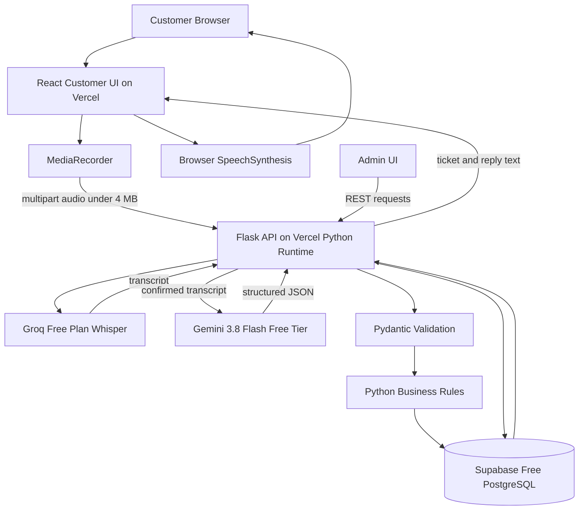
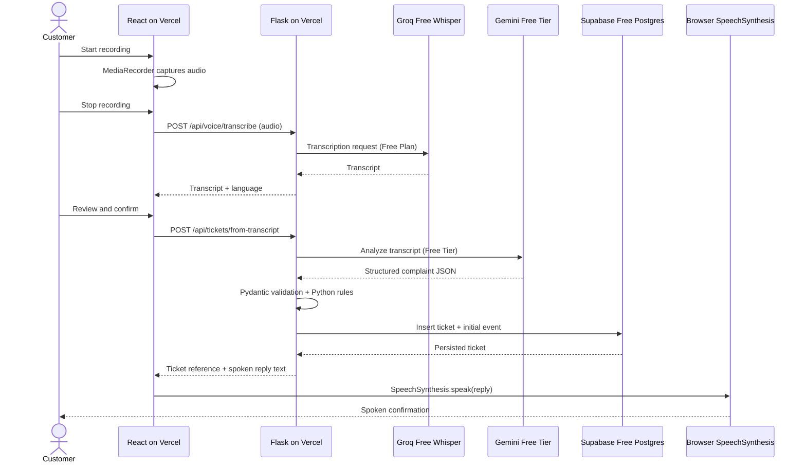

# 03. High-Level Architecture

## 1. Architecture style

Use a simple client-server architecture with one Flask backend. Do not create microservices.

- React is the presentation layer.
- Flask is the application and orchestration layer.
- Groq Free Plan Whisper performs speech-to-text.
- Gemini Free Tier performs complaint analysis.
- Python services enforce validation, business rules and actions.
- Supabase Free PostgreSQL persists application state.
- Browser SpeechSynthesis is the required zero-cost TTS.
- Vercel Hobby hosts the React frontend and Python/Flask backend as two projects from the same Git repository.

## 2. Component diagram

## 3. Component responsibilities

### React frontend

- Capture audio with `MediaRecorder`.
- Display recording and upload states.
- Send audio to Flask.
- Allow transcript editing and confirmation.
- Submit confirmed transcript with an idempotency key.
- Display ticket confirmation.
- Speak confirmation with browser SpeechSynthesis.
- Render admin ticket list and detail views.

### Flask backend

- Validate audio uploads, file type and size.
- Call Groq Free Plan Whisper.
- Return transcript and language metadata.
- Call Gemini Free Tier for structured extraction.
- Validate AI output with Pydantic.
- Apply deterministic category, priority and escalation rules.
- Create ticket and event records in one transaction.
- Enforce demo admin key on admin endpoints.
- Provide dashboard metrics.

### External AI services

- Groq Free Plan Whisper: audio to text.
- Gemini Free Tier: transcript to structured complaint analysis.
- Browser SpeechSynthesis: reply text to spoken audio, without an external API.

### Database

- Organizations.
- Voice sessions.
- Tickets.
- Ticket events.

## 4. Main sequence diagram

## 5. Failure handling

- Microphone denied: show a clear error and offer text entry.
- Unsupported MediaRecorder: show compatibility message and text-entry fallback.
- Groq timeout/rate limit/free quota exhausted: show manual text entry. Do not call a paid tier.
- Gemini failure/quota exhausted: show controlled manual-review fallback or ask the customer to retry. Do not claim AI analysis occurred.
- Database failure: do not show a successful ticket ID; allow safe retry with same idempotency key.
- SpeechSynthesis unavailable: retain visible text confirmation.
- Vercel function cold start or timeout: show loading/error state and bounded retry. Do not repeatedly retry quota errors.

## 6. Deployment topology

- Vercel Hobby project 1: React/Vite frontend, root directory `frontend/`.
- Vercel Hobby project 2: Python/Flask backend, root directory `backend/`; expose the WSGI app from `wsgi.py`.
- Supabase Free: PostgreSQL.
- Groq Free Plan: Whisper API, free quota only.
- Google AI Studio: Gemini Free Tier.
- Browser: SpeechSynthesis for TTS.

Use Vercel Hobby only for an eligible personal, non-commercial hackathon/portfolio demo. Each Vercel Function has a 4.5 MB request/response body limit; keep audio requests below 4 MB and recordings to 30-45 seconds. Check current Hobby function quotas before the event. If Vercel hosting is unavailable or the plan is not eligible, run React and Flask locally. No Render or paid backend hosting is required.

The browser never receives Groq, Gemini or database secrets.
