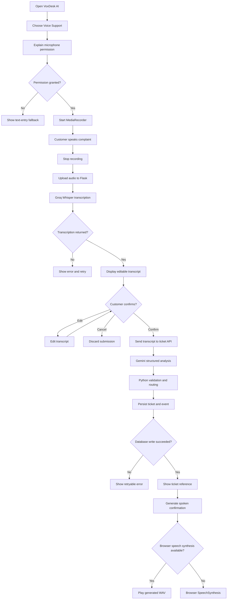

# 04. Customer Flow

## 1. Main journey

## 2. Customer screen states

| State | UI behavior |
|---|---|
| `idle` | Show microphone and optional text-entry controls |
| `requesting_permission` | Explain browser microphone permission |
| `recording` | Show timer, waveform or recording indicator and stop button |
| `uploading` | Disable duplicate submission and show upload progress |
| `transcribing` | Show that Groq Free Plan Whisper is processing the recording |
| `reviewing_transcript` | Show editable transcript and Confirm button |
| `analyzing` | Show AI analysis progress |
| `creating_ticket` | Show ticket creation progress |
| `ticket_created` | Show ticket reference, category, priority and status |
| `speaking` | Show audio playback state |
| `error` | Show actionable error and retry path |

## 3. Customer flow rules

- A recording must not upload until the customer stops it.
- Show a maximum recording duration of 45 seconds.
- Stop recording automatically at the duration limit.
- Keep the audio in browser memory until upload finishes.
- Do not save raw audio permanently.
- Always show the Whisper transcript before ticket creation.
- The customer can correct model transcription mistakes.
- Do not create a ticket until the customer confirms.
- Use one idempotency key for a single submission attempt and reuse it on network retry.
- After successful creation, show the ticket reference and a short plain-language explanation.
- The spoken reply must never claim that a refund, delivery or account change has actually happened. It only confirms complaint registration.

## 4. Example interaction

Customer:

> "My payment was deducted, but I did not receive an order confirmation."

Transcription preview:

> My payment was deducted, but I did not receive an order confirmation.

Customer confirms.

AI analysis result:

- Category: Payment
- Priority: Medium or High according to the deterministic rules in `07_AI_LOGIC.md`
- Department: Billing Support
- Status: Open
- Human review: determined by escalation rules

Customer-facing text:

> "Your complaint has been registered. Your ticket reference is VD-XXXXXXXX. The Billing Support team will review it."

The exact ticket reference must come from the database response, never from the LLM.

## 5. Text fallback

If microphone permission is denied or the browser does not support recording, provide a text area that submits the same transcript-processing endpoint. The app must clearly label this as text submission, not voice transcription.
