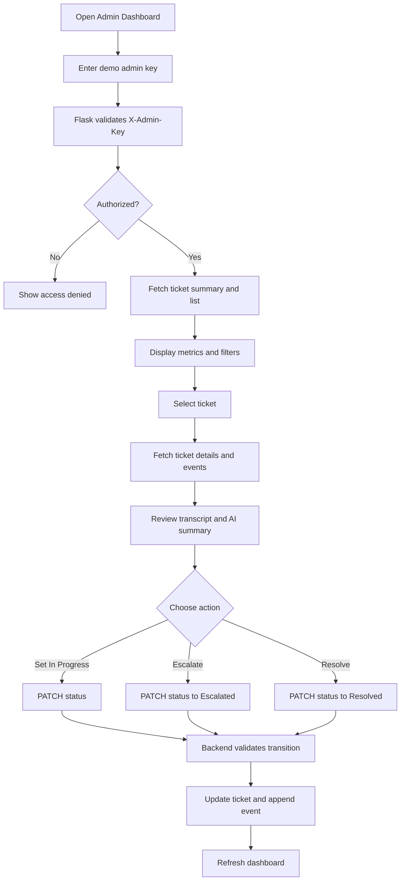

# 05. Admin Flow

## 1. Admin journey

## 2. Dashboard metrics

Show these four cards:

- Total tickets.
- Open tickets.
- High-priority tickets.
- Escalated tickets.

Metrics must be queried from the database. Do not calculate dashboard metrics from a hard-coded sample array.

## 3. Ticket list

Required columns:

- Ticket reference.
- Created time.
- Category.
- Priority.
- Department.
- Status.
- Escalated indicator.

Required filters:

- Status.
- Priority.
- Category.

Use pagination or a modest limit (for example, 50 records) rather than loading unbounded rows.

## 4. Ticket detail panel

Display:

- Ticket reference and creation time.
- Current status and priority.
- Category and assigned department.
- Original customer transcript.
- AI summary.
- Escalation flag and reason.
- Session reference.
- Event/activity history.

Do not display nonexistent speaker identity, call duration, call recording playback or sentiment scores. Those are outside the scope of this MVP.

## 5. Status transitions

Allowed transitions:

- `open` -> `in_progress`
- `open` -> `escalated`
- `in_progress` -> `escalated`
- `in_progress` -> `resolved`
- `escalated` -> `in_progress`
- `escalated` -> `resolved`

A resolved ticket is terminal for the MVP. Reject unsupported transitions with HTTP 409. Set `escalated = true` only while `status = escalated`; clear it when the ticket transitions out of the escalated state. Keep the escalation event in the history for auditability.

## 6. Demo authentication

Use a simple server-side demo admin key for the hackathon:

- Store `ADMIN_API_KEY` only in the Flask environment.
- Admin UI asks the presenter to enter the key.
- Send it as `X-Admin-Key` header for every admin API call.
- Keep the key in React memory, not in source code or a Vite environment variable.
- Compare keys using a constant-time comparison.
- Return 401 for missing or invalid keys.

This is a hackathon demo gate, not production authentication. State that clearly in the README and demo presentation. Production would require real user authentication, role-based authorization and tenant-scoped access.
