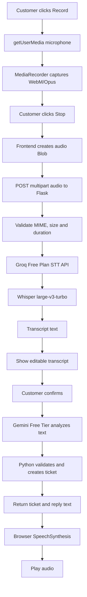

# 06. Voice Pipeline: Free-Only Whisper STT and TTS

## 1. Model separation

Whisper models perform speech-to-text (STT). They do not generate speech. TTS is a separate component.

Mandatory path:

- STT: Groq Free Plan API + `whisper-large-v3-turbo`.
- AI text analysis: Gemini API Free Tier + `gemini-3.8-flash`.
- TTS: browser `window.speechSynthesis`.

There is no external TTS path. Browser SpeechSynthesis is the only TTS implementation. No paid provider, optional hosted TTS, or automatic paid fallback is permitted.

## 2. Voice pipeline overview



## 3. Frontend audio capture

Use `navigator.mediaDevices.getUserMedia({ audio: true })` and `MediaRecorder`.

Requirements:

- Check `navigator.mediaDevices` and `MediaRecorder` support.
- Choose a supported MIME type with `MediaRecorder.isTypeSupported`.
- Prefer `audio/webm;codecs=opus` when supported.
- Preserve the actual recorder MIME type when creating the Blob.
- Use filename `complaint.webm` or a matching extension.
- Stop all media tracks after recording.
- Limit duration to 45 seconds.
- Reject zero-byte recordings.
- Upload using `FormData` field `audio`.
- Do not set the multipart `Content-Type` header manually.

Example:

```javascript
const stream = await navigator.mediaDevices.getUserMedia({ audio: true });
const mimeType = MediaRecorder.isTypeSupported("audio/webm;codecs=opus")
  ? "audio/webm;codecs=opus"
  : "audio/webm";
const recorder = new MediaRecorder(stream, { mimeType });
const chunks = [];

recorder.ondataavailable = (event) => {
  if (event.data.size > 0) chunks.push(event.data);
};

recorder.onstop = async () => {
  const blob = new Blob(chunks, { type: recorder.mimeType });
  stream.getTracks().forEach((track) => track.stop());
  if (!blob.size) throw new Error("No audio was captured.");
  const body = new FormData();
  body.append("audio", blob, "complaint.webm");
  // POST body to /api/voice/transcribe.
};

recorder.start();
```

## 4. Flask transcription endpoint

Endpoint: `POST /api/voice/transcribe`

Content type: `multipart/form-data`

File field: `audio`

Backend steps:

1. Confirm the file exists.
2. Validate filename extension and MIME type against the allowlist.
3. Enforce a 4 MB maximum for Vercel compatibility and a 45-second UI recording limit.
4. Reject empty or malformed audio.
5. Forward the audio to Groq's transcription endpoint using the Free Plan API key.
6. Default model to `whisper-large-v3-turbo`; model selection is server-side.
7. Use `language="en"` initially; do not make language a free-form model override.
8. Apply timeout and catch provider errors.
9. Return transcript and language metadata if available.
10. Do not persist raw audio; delete temporary files in `finally`.

Groq endpoint:

`https://api.groq.com/openai/v1/audio/transcriptions`

Python integration direction:

```python
from groq import Groq

client = Groq(api_key=settings.GROQ_API_KEY)

with open(temp_audio_path, "rb") as audio_file:
    result = client.audio.transcriptions.create(
        file=(safe_filename, audio_file.read()),
        model="whisper-large-v3-turbo",
        language="en",
        response_format="json",
    )

transcript = result.text.strip()
```

Verify the installed SDK's current method signature against Groq's official documentation. The code must not enable a paid service tier.

## 5. Free-tier exhaustion behavior

If Groq returns 429, quota exceeded, account restriction or billing response:

- Stop provider retries except a single bounded retry where `Retry-After` explicitly indicates a short transient wait.
- Do not switch to a paid Groq tier.
- First offer manual transcript entry so the core ticket workflow can still be demonstrated.
- If preconfigured and tested locally, run `faster-whisper` with a small/base model on the developer machine.
- Show a clear message: "Free transcription quota is unavailable. Enter or paste the complaint text, or retry later. No paid service was called."

Do not download a large model at runtime during the demo.

## 6. Transcript review

After Whisper returns the transcript, display an editable text area. Require customer confirmation before sending it to Gemini and creating a ticket. This matters because STT can misrecognize names, product IDs, dates and amounts.

## 7. Required TTS: browser SpeechSynthesis

This is the default and sufficient for the hackathon.

```javascript
export function speakConfirmation(text) {
  if (!("speechSynthesis" in window)) return false;

  window.speechSynthesis.cancel();
  const utterance = new SpeechSynthesisUtterance(text);
  utterance.lang = "en-IN";
  utterance.rate = 1;
  utterance.pitch = 1;
  window.speechSynthesis.speak(utterance);
  return true;
}
```

Use a browser-provided Indian English voice if available. Otherwise use the browser's default English voice. If no speech synthesis is available, retain the visible text confirmation.

## 8. TTS failure behavior

- Browser SpeechSynthesis is the sole TTS implementation.
- If the browser does not support TTS or no usable voice is available, retain the visible text confirmation.
- TTS is a non-critical post-ticket step. TTS failure must not invalidate ticket creation.
- Do not add a hosted TTS API or download a separate TTS model during the six-hour build.

## 9. Audio privacy

- Clearly show recording state.
- Stop recording after 45 seconds or when the user presses Stop.
- Do not persist audio.
- Explain that the audio is sent to the configured transcription provider.
- Use synthetic complaints.
- Do not log audio bytes, API keys or unnecessary transcript contents.
