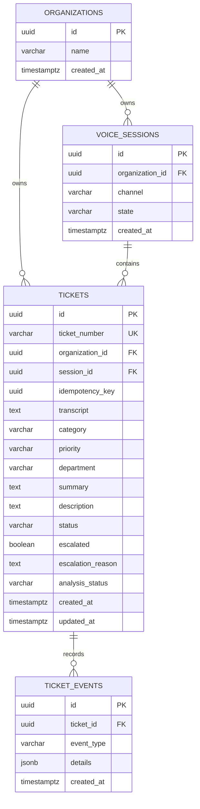

# 09. Database Schema

Use Supabase-hosted PostgreSQL. Flask connects through SQLAlchemy and a PostgreSQL driver. The frontend must never connect using the database password or service-role key.

## 1. Entity relationship

## 2. Tables

### organizations

- `id UUID PRIMARY KEY`.
- `name VARCHAR(120) NOT NULL`.
- `created_at TIMESTAMPTZ NOT NULL DEFAULT now()`.

Seed one organization for the hackathon demo. Do not accept an arbitrary organization ID from an unauthenticated public request.

### voice_sessions

- `id UUID PRIMARY KEY`.
- `organization_id UUID NOT NULL REFERENCES organizations(id)`.
- `channel VARCHAR(32) NOT NULL DEFAULT 'web_voice'`.
- `state VARCHAR(24) NOT NULL DEFAULT 'active'`.
- `created_at TIMESTAMPTZ NOT NULL DEFAULT now()`.

Do not persist raw audio in this table.

### tickets

- `id UUID PRIMARY KEY`.
- `ticket_number VARCHAR(24) NOT NULL UNIQUE`.
- `organization_id UUID NOT NULL REFERENCES organizations(id)`.
- `session_id UUID REFERENCES voice_sessions(id)`.
- `idempotency_key UUID NOT NULL`.
- `transcript TEXT NOT NULL`.
- `category VARCHAR(24) NOT NULL`.
- `priority VARCHAR(16) NOT NULL`.
- `department VARCHAR(64) NOT NULL`.
- `summary VARCHAR(500) NOT NULL`.
- `description TEXT`.
- `status VARCHAR(24) NOT NULL DEFAULT 'open'`.
- `escalated BOOLEAN NOT NULL DEFAULT false`.
- `escalation_reason TEXT`.
- `analysis_status VARCHAR(24) NOT NULL DEFAULT 'completed'`.
- `created_at TIMESTAMPTZ NOT NULL DEFAULT now()`.
- `updated_at TIMESTAMPTZ NOT NULL DEFAULT now()`.

Unique constraint: `(organization_id, idempotency_key)`.

Add CHECK constraints for allowed category, priority, status and analysis status values.

Generate ticket number in Flask, for example `VD-` followed by the first eight uppercase characters of a UUID. Do not ask Gemini to create the number.

### ticket_events

- `id UUID PRIMARY KEY`.
- `ticket_id UUID NOT NULL REFERENCES tickets(id) ON DELETE CASCADE`.
- `event_type VARCHAR(40) NOT NULL`.
- `details JSONB NOT NULL DEFAULT '{}'::jsonb`.
- `created_at TIMESTAMPTZ NOT NULL DEFAULT now()`.

Events are append-only in application behavior. Required event types:

- `TICKET_CREATED`
- `TICKET_ESCALATED`
- `STATUS_CHANGED`

## 3. Indexes

Create indexes for:

- `tickets(organization_id, created_at DESC)`.
- `tickets(organization_id, status)`.
- `tickets(organization_id, priority)`.
- `tickets(organization_id, category)`.
- `ticket_events(ticket_id, created_at ASC)`.

## 4. Transaction rules

Ticket creation must insert the ticket and `TICKET_CREATED` event in one transaction. A status change must update the ticket and insert `STATUS_CHANGED` in one transaction.

On idempotency-key retry, return the already-created ticket. Do not make a second row.

## 5. Organization scoping

For the hackathon MVP, one server-configured demo organization is enough. Resolve its UUID in backend configuration or database seed logic. Every ticket query must include organization scope. Never trust a client-supplied `organization_id`.

This is organization-aware data modeling, not production-ready multi-tenant authentication. Production requires verified user identity, tenant membership checks and appropriate database policies.

## 6. Supabase configuration

Use a PostgreSQL connection string in `DATABASE_URL`. Prefer Supabase's documented direct or pooler connection mode appropriate to the hosting environment. Do not expose `DATABASE_URL` to React.

For SQLAlchemy, use an appropriate pool configuration for a small web service and handle connection failures cleanly. Do not store files/audio in the database.
