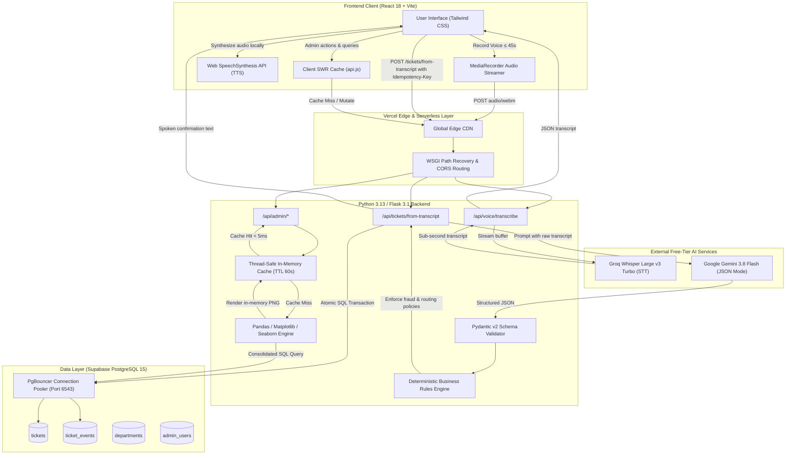
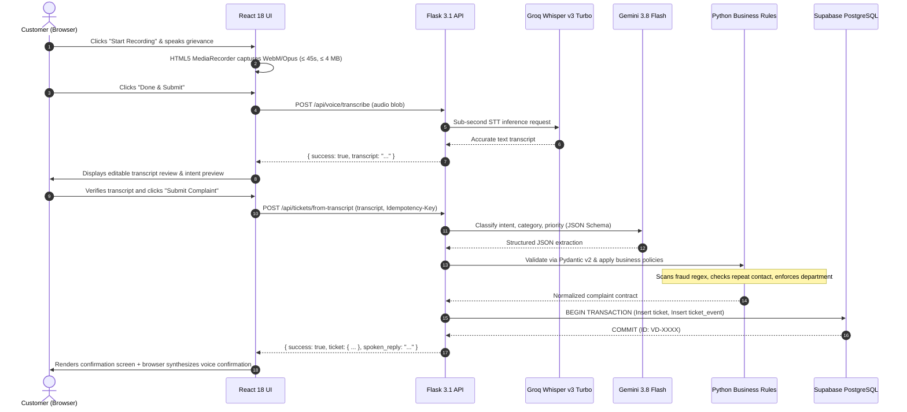

# VoxDesk AI — High-Level Architecture & Technical Specification

> **System Blueprint & Architectural Design**  
> **Author:** Naman Kumar  
> **Repository:** [https://github.com/naman-kumar1212/VoxDesk-AI](https://github.com/naman-kumar1212/VoxDesk-AI)  
> **Live Web App:** [https://voxdesk-web-lac.vercel.app](https://voxdesk-web-lac.vercel.app)  
> **Live API Base:** [https://voxdesk-api.vercel.app](https://voxdesk-api.vercel.app)

---

## 1. System Architecture Diagram



---

## 2. End-to-End Sequence Diagram



---

## 3. Component Architecture & Rationale

### 3.1. Frontend Layer (React 18 + Vite)
- **Framework:** React 18 with Vite for instantaneous Hot Module Replacement (HMR) and optimized rollup bundle compilation.
- **Styling:** Tailwind CSS with CSS-first variable architecture and responsive design breakpoints.
- **Audio Visualizer:** Native HTML5 Canvas visualizer rendering real-time sine/waveform animations synchronized with audio volume.
- **Client Cache (SWR):** Custom in-memory SWR caching layer in `frontend/src/services/api.js` providing sub-millisecond tab switching across Admin Dashboard, Tickets, Analytics, Departments, and Users.

### 3.2. Backend Microframework Layer (Python 3.13 / Flask 3.1)
- **Microframework:** Flask 3.1 selected for minimal overhead, fast cold-start in serverless execution, and explicit routing control.
- **ORM & Data Mapping:** SQLAlchemy 2.0 with connection pooling (`pool_size=10`, `max_overflow=20`, `pool_recycle=300`) and TCP keepalives.
- **Schema Contracts:** Pydantic v2 models (`ComplaintAnalysis`, `CreateTicketRequest`, `TicketStatusUpdateRequest`) ensuring strict boundary validation between external LLM outputs and database operations.

### 3.3. Speech-to-Text Pipeline (Groq Whisper Large v3 Turbo)
- **Engine:** Whisper Large v3 Turbo hosted on Groq LPU inference hardware.
- **Latency Advantage:** Ingests audio and returns full transcripts in **sub-800ms**, compared to 3–5 seconds on traditional cloud providers.
- **Zero Cost:** Operates within Groq’s developer free tier quota.

### 3.4. AI Classification & Intent Parsing (Google Gemini 3.8 Flash)
- **Engine:** Google Gemini 3.8 Flash running in native JSON structured output mode.
- **Task:** Extracts summary, detailed description, customer category (`payment`, `delivery`, `account`, `orders`, `technical`, `other`), urgency score (1-5), sentiment (`positive`, `neutral`, `negative`, `frustrated`), and natural spoken response text.
- **Security Boundary:** Untrusted customer transcripts are strictly quarantined within prompts. Prompt injection attempts cannot bypass business validation logic.

### 3.5. Deterministic Rules Engine
- **Priority Escalation Matrix:**
  - *Fraud Keywords (`fraud`, `stolen`, `unauthorized`, `scam`)* $\rightarrow$ Automatically forces `priority = 'high'` and `escalated = true`.
  - *Repeated Contact (`second time`, `already reported`, `days ago`)* $\rightarrow$ Sets `status = 'escalated'`.
  - *Department Reassignment:* Guarantees tickets map to operational teams regardless of model variance:
    - `payment` $\rightarrow$ Billing Support
    - `delivery`, `orders` $\rightarrow$ Logistics
    - `technical` $\rightarrow$ Technical Support
    - `account` $\rightarrow$ Account Support

### 3.6. Persistence & Transaction Layer (Supabase PostgreSQL 15)
- **ACID Guarantees:** Atomic multi-table transactions ensure that whenever a ticket is created or updated, an immutable `ticket_events` entry is written simultaneously.
- **Indexing Strategy:**
  - Composite B-tree index on `(organization_id, status)` for rapid filtering.
  - Index on `ticket_number` for instant tracking lookups.
  - Foreign key cascades ensuring relational integrity.

---

## 4. Performance Engineering Blueprint

### The Bottleneck
Initial testing across transatlantic WAN (Supabase pooler in Sydney/AWS, API in Vercel edge) exhibited 10–20 second delays when navigating between admin pages.

### Architectural Optimizations

```
1. SQL Consolidation
   Before: 9 sequential DB queries (5,241ms latency)
   After:  1 single query with PostgreSQL FILTER (WHERE ...) (2,710ms latency)

2. In-Memory Chart Cache
   Before: 4 database connections + 4 Matplotlib renders per view (9,140ms)
   After:  Thread-safe in-memory cache with 60s TTL (4.5ms) -> 450x Speedup

3. Client SWR Cache
   Before: Network fetch on every React view mount
   After:  30s in-memory cache with instant cache hits (< 1ms)
```

---

## 5. Security & Isolation Matrix

| Threat Vector | Mitigation Strategy | Implementation |
|---|---|---|
| **API Key Exposure** | Server-only credential isolation | `.env` variables loaded only in Python runtime; zero keys in Vite client bundle. |
| **Prompt Injection** | Strict Pydantic parsing & schema bounds | Customer transcripts treated as untrusted string inputs; Pydantic rejects schema drifts. |
| **Duplicate Submissions** | Client UUID Idempotency Keys | `Idempotency-Key` header enforced; duplicate requests return identical existing ticket. |
| **Denial of Service** | Audio payload and duration constraints | 45-second duration limit; 4 MB hard size cap; memory buffer discard after STT. |
| **Unauthorized Admin Actions** | Role-based authentication | Supabase Auth bcrypt credentials + optional legacy `X-Admin-Key` verification. |
