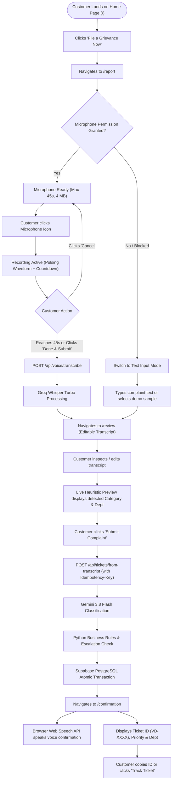
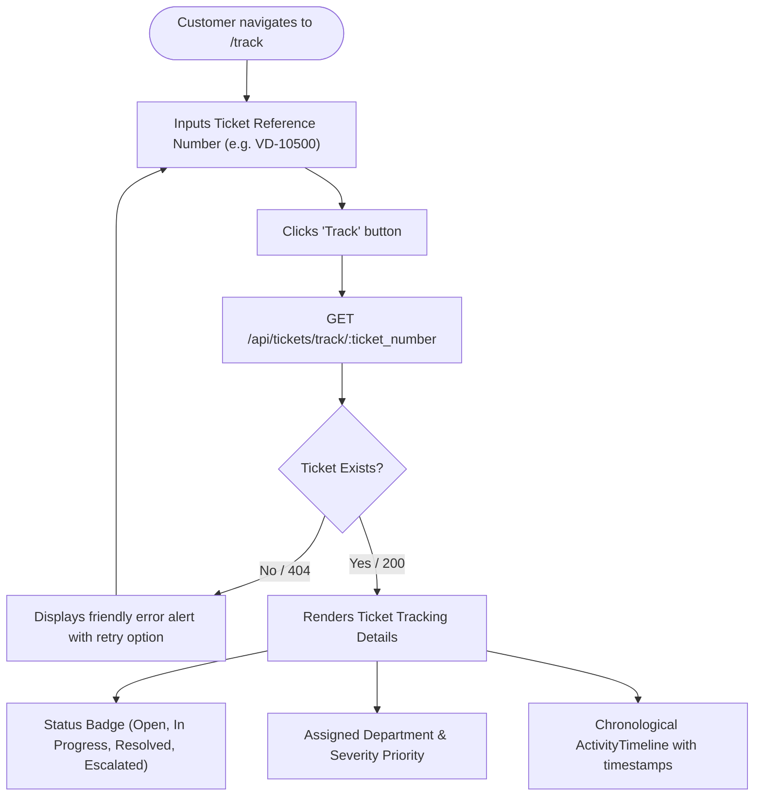
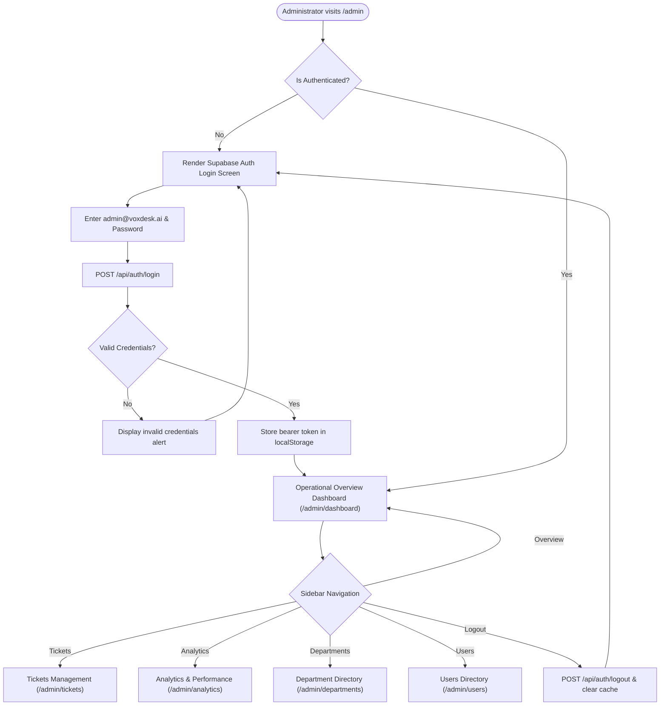
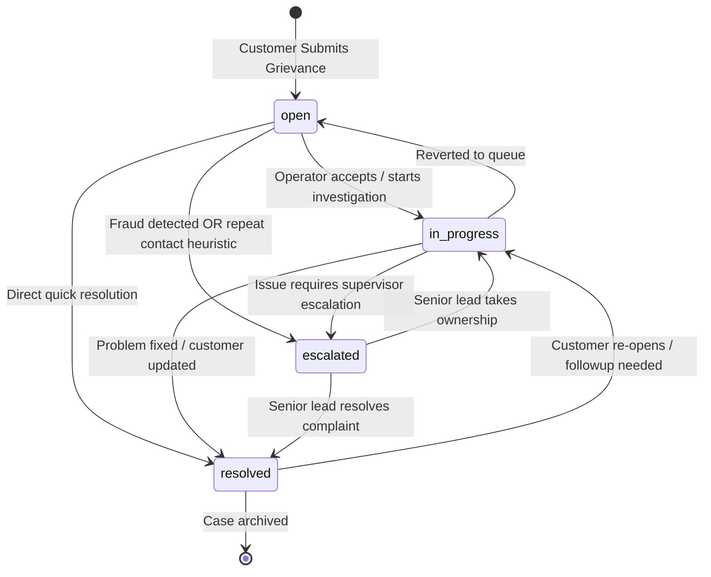
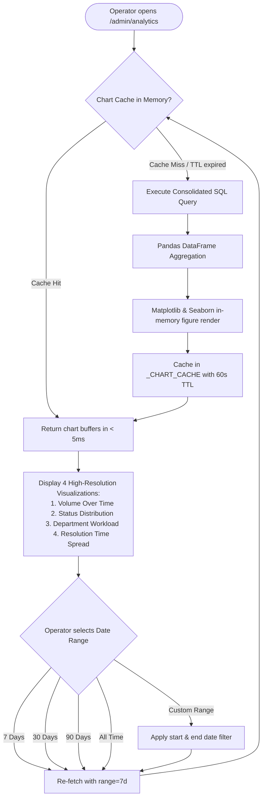

# VoxDesk AI — User Flow & Interaction Lifecycles

> **Interactive Journeys & System State Machines**  
> **Author:** Naman Kumar  
> **Repository:** [https://github.com/naman-kumar1212/VoxDesk-AI](https://github.com/naman-kumar1212/VoxDesk-AI)  
> **Live App:** [https://voxdesk-web-lac.vercel.app](https://voxdesk-web-lac.vercel.app)

---

## 1. Customer Interaction Flows

### Flow 1: Primary Voice Grievance Submission Flow

---

### Flow 2: Customer Public Grievance Tracking Flow

---

## 2. Administrator & Operator Flows

### Flow 3: Administrator Daily Triage & Console Navigation

---

### Flow 4: Ticket Investigation & Lifecycle State Machine

---

### Flow 5: Analytics & Operational Intelligence Flow

